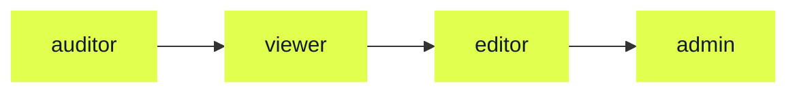
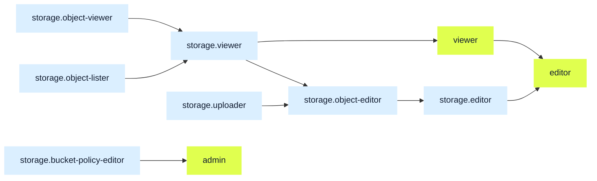

# Roles for Nebius AI Cloud groups

Source: https://docs.nebius.com/iam/authorization/roles

> ## Documentation Index
> Fetch the complete documentation index at: https://docs.nebius.com/llms.txt
> Use this file to discover all available pages before exploring further.

# Roles for Nebius AI Cloud groups

Roles are sets of permissions that are granted to users and service accounts to work with resources in Nebius AI Cloud.

Roles are assigned to [groups](https://docs.nebius.com/iam/authorization/groups/index.md):

* **Default groups** in each tenant (`auditors`, `viewers`, `editors`, `admins`) have corresponding predefined [general roles](#general-roles).
* When you create **custom groups**, you should create at least one access permit that assigns a role to the group. You can configure an access permit to apply to the entire tenant, a project within it or an individual resource within it. For more details and instructions, see [Managing custom groups](https://docs.nebius.com/iam/authorization/groups/manage.md).

## List of roles

The following roles are available:

* [General](#general-roles)

  * `auditor`
  * `viewer`
  * `editor`
  * `admin`

* [Security](#security)

  * `security-auditor`

* [Compute](#compute)

  * `compute.instance-power-operator`
  * `compute.serial-console-user`
  * `compute.use-via-object-storage`

* [Object Storage](#object-storage)

  * `storage.viewer`
  * `storage.uploader`
  * `storage.editor`
  * `storage.object-editor`
  * `storage.object-viewer`
  * `storage.object-lister`
  * `storage.bucket-policy-editor`

* [Audit Logs](#audit-logs)

  * `auditlogs.audit-event-viewer`
  * `auditlogs.audit-event-exporter`

* [SecretStash](#secretstash)

  * `mysterybox.payload-viewer`

* [Nebius Tunnels](#nebius-tunnels)

  * `applicationtunnel.agent`

- [Data Subject Requests](#data-subject-requests)

  * `dsr.admin`

## General roles

*General roles* grant permissions for resources from all services. For example, if you are in a group that has the `admin` role within a tenant, you can perform all actions listed below on all Compute virtual machines, Managed Kubernetes clusters, etc. in the tenant.

The default groups within a tenant are assigned corresponding tenant-wide general roles.

> [!WARNING]
>
> Default groups and general roles grant a wide range of permissions across all services. To follow the [principle of least privilege](https://en.wikipedia.org/wiki/Principle_of_least_privilege), create custom groups and assign roles with as few permissions as possible to these groups.

The following general roles are available:

* `auditor`: view **certain types** of resources **without access to data**.
* `viewer`: view **most types** of resources (except some resources related to access management, security and similar areas) and **access data** in them (for example, download objects in buckets).
* `editor`: view **and manage** most types of resources and access data in them.
* `admin`: view and manage **all types** of resources and access data in them.

The graph below shows how general roles are related to each other (the arrow means "is a sub-role of"):

> [!NOTE]
>
> The `auditor` role is going to be deprecated in the near future. We recommend using the `viewer` role and `viewers` default group instead.

General roles contain the following permissions:

| **Resource type** | `auditor` (`auditors` default group) | `viewer` (`viewers` default group) | `editor` (`editors` default group) | `admin` (`admins` default group) |
| - | - | - | - | - |
| **Compute** | `auditor` | `viewer` | `editor` | `admin` |
| Virtual machines | - | View | View Create Modify Stop Start Delete | View Create Modify Stop Start Delete |
| GPU clusters | - | View | View Create Add/remove VMs Modify Delete | View Create Add/remove VMs Modify Delete |
| Disks | - | View | View Create Attach to/detach from VMs Modify Delete | View Create Attach to/detach from VMs Modify Delete |
| Shared filesystems | - | View | View Create Attach to/detach from VMs Use through Object Storage Modify Delete | View Create Attach to/detach from VMs Use through Object Storage Modify Delete |
| Boot disk images | - | View | View Create Modify Delete | View Create Modify Delete |
| Disk snapshots | - | View | View Create Modify Delete | View Create Modify Delete |
| Serial console | - | - | - | Use |
| **Soperator** | `auditor` | `viewer` | `editor` | `admin` |
| Clusters | - | View | View Create Modify Stop Start Delete | View Create Modify Stop Start Delete |
| **Managed Service for Kubernetes** | `auditor` | `viewer` | `editor` | `admin` |
| Clusters | - | View | View Create Modify Delete | View Create Modify Delete |
| Node groups | - | View | View Create Modify Delete | View Create Modify Delete |
| **Serverless AI** | `auditor` | `viewer` | `editor` | `admin` |
| Devlabs | - | View | View Create Modify Stop Start Delete | View Create Modify Stop Start Delete |
| Endpoints | - | View | View Create Modify Stop Start Delete | View Create Modify Stop Start Delete |
| Jobs | - | View | View Create Modify Cancel Delete | View Create Modify Cancel Delete |
| **Object Storage** | `auditor` | `viewer` | `editor` | `admin` |
| Buckets | View | View | View Create Delete Undelete Purge | View Create Delete Undelete Purge |
| Objects, versions | - | List Download | List Download Upload Delete Restore | List Download Upload Delete Restore |
| Multipart uploads | - | List uploads | List uploads List parts Create | List uploads List parts Create |
| Transfers | View transfers View iterations | View transfers View iterations | View transfers View iterations Create Modify Stop Start Delete | View transfers View iterations Create Modify Stop Start Delete |
| Bucket settings | View | View | View Modify | View Modify |
| Bucket policies | - | - | - | View Modify |
| **Managed Service for PostgreSQL®** | `auditor` | `viewer` | `editor` | `admin` |
| Clusters | - | View | View Create Modify Stop Start Delete | View Create Modify Stop Start Delete |
| **Container Registry** | `auditor` | `viewer` | `editor` | `admin` |
| Registries | - | View | View Create Modify Delete | View Create Modify Delete |
| Images | - | List Pull | List Pull Push Modify | List Pull Push Modify |
| **Managed Service for MLflow** | `auditor` | `viewer` | `editor` | `admin` |
| Clusters | - | View | View Stop Start | View Stop Start Create Modify Delete |
| **Applications** | `auditor` | `viewer` | `editor` | `admin` |
| Applications for Managed Kubernetes | - | View | View Create Create/delete endpoints Delete | View Create Create/delete endpoints Delete |
| **Observability** | `auditor` | `viewer` | `editor` | `admin` |
| Metrics | - | View | View | View |
| Alerts | - | View | View Create Modify Delete | View Create Modify Delete |
| Logs | - | View | View Write | View Write |
| **Virtual Networks** | `auditor` | `viewer` | `editor` | `admin` |
| IP address pools | - | View | View | View |
| IP address allocations | - | View | View Create Assign to/de-assign from resources Delete | View Create Assign to/de-assign from resources Delete |
| Networks | - | View | View Create Modify Delete | View Create Modify Delete |
| Subnets | - | View | View Create Use Modify Delete | View Create Use Modify Delete |
| Routing tables | - | View | View Create Assign to subnets Modify Delete | View Create Assign to subnets Modify Delete |
| Routes | - | View | View Create Modify Delete | View Create Modify Delete |
| Security groups | - | View | View Create Assign to VMs Modify Delete | View Create Assign to VMs Modify Delete |
| Security rules | - | View | View Create Modify Delete | View Create Modify Delete |
| DNS zones | View | View | View Create Modify Delete | View Create Modify Delete |
| DNS records | - | View | View Create Modify Delete | View Create Modify Delete |
| **Billing** | `auditor` | `viewer` | `editor` | `admin` |
| Billing details – general: payer type, country, payment method, etc. | View | View | View | View |
| Billing details – sensitive: payer name, billing address, etc. | - | View | View | View |
| Documents | View | View | View | View |
| Prices | View | View | View | View |
| Pay-as-you-go balance | - | View | View | View |
| Usage details | - | View | View | View |
| Transactions | - | View | View | View |
| Budgets | - | View | View Create Modify Delete | View Create Modify Delete |
| **Identity and Access Management** | `auditor` | `viewer` | `editor` | `admin` |
| Users | View | View | View | View |
| Groups | View | View | View | View Add members Remove members |
| Service accounts | View | View | View Create Modify Delete | View Create Modify Delete |
| Authorized keys | View | View | View | View Upload Modify Delete |
| Access keys | View | View | View | View Create Modify Delete |
| **Audit Logs** | `auditor` | `viewer` | `editor` | `admin` |
| Events | - | - | - | View |
| Exports | - | - | - | View Create |
| **Key Management Service** | `auditor` | `viewer` | `editor` | `admin` |
| Symmetric and asymmetric keys | View List | View List | View List Create Update Delete Restore | View List Create Update Delete Restore |
| **SecretStash** | `auditor` | `viewer` | `editor` | `admin` |
| Secrets | View List | View List | View List Create Update Delete Restore | View List Create Update Delete Restore |
| Versions | View List | View List | View List Create Delete Restore | View List Create Delete Restore |
| Payloads | - | - | - | View |
| **Quotas** | `auditor` | `viewer` | `editor` | `admin` |
| Limits | - | View | View | View |
| Requests | - | View | View | View Create Cancel |
| **Support** | `auditor` | `viewer` | `editor` | `admin` |
| Regular requests | View Create Comment Attach files Close | View Create Comment Attach files Close | View Create Comment Attach files Close | View Create Comment Attach files Close |
| Data Subject Requests to receive copies of data | - | - | - | View Create Comment Attach files Close |
| Data Subject Requests to erase data | - | - | - | View Create Comment Attach files Close |

## Security

*Security roles* grant read-only access to the configuration of resources from all services, without access to the data in these resources. These roles are intended for third-party security and compliance platforms that assess how the resources of a tenant are configured: cloud security posture management (CSPM) systems, vulnerability scanners and posture-monitoring agents.

The only available security role is `security-auditor`, which allows you to view the configuration of resources within a tenant or a project, but not the data in these resources, billing information or personal information beyond names and email addresses.

`security-auditor` contains the following permissions:

| **Resource type** | `security-auditor` |
| - | - |
| **Compute** | `security-auditor` |
| Virtual machines | View |
| GPU clusters | View |
| Disks | View |
| Boot disk images | View |
| Disk snapshots | View |
| **Managed Service for Kubernetes** | `security-auditor` |
| Clusters | View |
| Node groups | View |
| **Container Registry** | `security-auditor` |
| Registries | View |
| Images | List |
| **Object Storage** | `security-auditor` |
| Buckets | View |
| Bucket settings | View |
| Objects, versions | - |
| **Virtual Networks** | `security-auditor` |
| Networks | View |
| Subnets | View |
| Routing tables | View |
| Routes | View |
| Security groups | View |
| Security rules | View |
| DNS zones | View |
| DNS records | View |
| **Observability** | `security-auditor` |
| Alerts | View |
| **Identity and Access Management** | `security-auditor` |
| Users | View¹ |
| Groups | View |
| Service accounts | View |
| **Key Management Service** | `security-auditor` |
| Symmetric and asymmetric keys | View² List |
| **Quotas** | `security-auditor` |
| Limits | View |
| **Billing** | `security-auditor` |
| Billing details, documents, transactions | - |

¹ For users, `security-auditor` provides access to names and email addresses, so that a security platform can attribute its findings to a specific user, but not to phone numbers or profile photos.

² For Key Management Service keys, `security-auditor` provides access to the metadata of a key, but not to the key material.

The set of permissions that `security-auditor` provides can expand as new resource types become available in Nebius AI Cloud. Permissions are not removed from the role, so the access permits that grant it keep working without any changes on your side.

## Compute

*Compute roles* grant permissions for [Compute](https://docs.nebius.com/compute/index.md) virtual machines and shared filesystems.

The following Compute roles are available:

* `compute.instance-power-operator`: perform power operations on virtual machines without broader Compute permissions
* `compute.serial-console-user`: use the serial console on virtual machines for interactive troubleshooting
* `compute.use-via-object-storage`: access data stored on shared filesystems through filesystem buckets in Object Storage

Compute roles contain the following permissions:

| **Compute** | `compute.instance-power-operator` | `compute.serial-console-user` | `compute.use-via-object-storage` |
| - | - | - | - |
| Virtual machines | View View metadata Start Stop View operations | - | - |
| Serial console | - | Use | - |
| Shared filesystems | - | - | Use through Object Storage |

## Object Storage

*Object Storage roles* grant permissions for [Object Storage](https://docs.nebius.com/object-storage/index.md) buckets and objects.

The following Object Storage roles are available:

* `storage.object-viewer`: download objects and view their metadata
* `storage.object-lister`: list objects and view their version metadata
* `storage.viewer`: view buckets, list and download objects but not upload them
* `storage.uploader`: view buckets, upload objects but not list or download them
* `storage.object-editor`: view buckets, list, download, upload and manage objects
* `storage.editor`: view and manage buckets, list, download, upload and manage objects
* `storage.bucket-policy-editor`: manage bucket policies

The graph below shows how Object Storage roles are related to each other and to general roles, shown in green (the arrow means "is a sub-role of"):

Object Storage roles contain the following permissions:

| **Object Storage** | `storage.object-viewer` | `storage.object-lister` | `storage.viewer` | `storage.uploader` | `storage.object-editor` | `storage.editor` | `storage.bucket-policy-editor` |
| - | - | - | - | - | - | - | - |
| Buckets | - | - | View | View | View | View Create Delete | View |
| Objects, versions | Download | List | List Download | Upload | List Download Upload Delete Restore | List Download Upload Delete Restore | - |
| Multipart uploads | - | - | List uploads | List parts Create | List uploads List parts Create | List uploads List parts Create | - |
| Transfers | - | - | - | - | - | - | - |
| Bucket settings | - | - | View | View | View | View Modify | - |
| Bucket policies | - | - | - | - | - | View | Modify |

For more details on the actions available to different roles, see [Actions supported by Object Storage roles](https://docs.nebius.com/object-storage/supported-actions.md).

If you want to configure fine-grained access to objects in a bucket, apply a [bucket policy](https://docs.nebius.com/object-storage/buckets/bucket-policy.md) in Object Storage.

## Audit Logs

*Audit Logs roles* grant permissions for viewing or exporting events in [Audit Logs](https://docs.nebius.com/audit-logs/index.md).

The following Audit Logs roles are available:

* `auditlogs.audit-event-viewer`: view audit events for the tenant
* `auditlogs.audit-event-exporter`: view and list available audit log exports, start a new export and cancel an export

Audit Logs roles contain the following permissions:

| **Audit Logs** | `auditlogs.audit-event-viewer` | `auditlogs.audit-event-exporter` |
| - | - | - |
| Events | View | - |
| Exports | - | View List Start Cancel |

## SecretStash

> [!NOTE]
>
> MysteryBox is now called SecretStash. The Nebius AI Cloud CLI, API and Terraform provider still use the `mysterybox` service identifier. Keep using `mysterybox` in scripts and manifests.

*SecretStash roles* grant permissions for [SecretStash](https://docs.nebius.com/mysterybox/index.md) secrets.

The only available role is `mysterybox.payload-viewer`, which is a sub-role of the `admin` general role.

`mysterybox.payload-viewer` contains the following permissions:

| **SecretStash** | `mysterybox.payload-viewer` |
| - | - |
| Secrets | - |
| Versions | - |
| Payloads | View |

> [!WARNING]
>
> Creating a secret or a version of a secret does not automatically grant you access to view payloads in that secret or version. The `editor` role is enough to create a secret or a version, but viewing payloads requires the `mysterybox.payload-viewer` role, which is a sub-role of `admin` but not `editor`.

## Nebius Tunnels

*Nebius Tunnels roles* grant permissions for [tunnels](https://docs.nebius.com/tunnels/index.md) and the agents that connect to them.

The only available role is `applicationtunnel.agent`, which allows a service account to connect a tunnel agent to a tunnel (`resource.applicationtunnel.connect`). Grant it on the tunnel itself, or on a project or tenant to cover multiple tunnels.

`applicationtunnel.agent` contains the following permissions:

| **Nebius Tunnels** | `applicationtunnel.agent` |
| - | - |
| Tunnels | Connect |

## Data Subject Requests

*Roles for Data Subject Requests* (DSRs) grant permissions to receive copies of personal and non-personal data stored in a tenant and its resources in a machine-readable format, and erase the data if required. If you represent a legal entity and want to [send a DSR](https://docs.nebius.com/overview/support.md#data-subject-requests), you need a role for DSRs.

The only available role for DSRs is `dsr.admin`, which allows you to create Data Subject Requests and general support requests. It is a sub-role of the `admin` general role.

`dsr.admin` contains the following permissions:

| **Support** | `dsr.admin` |
| - | - |
| Regular requests | View Create Comment Attach files Close |
| Data Subject Requests to receive copies of data | View Create Comment Attach files Close |
| Data Subject Requests to erase data | View Create Comment Attach files Close |

> [!WARNING]
>
> The `dsr.admin` role allows you to receive copies of and erase **all** personal and non-personal data in the tenant. Assign this role with caution.

***

*Postgres, PostgreSQL and the Slonik Logo are trademarks or registered trademarks of the PostgreSQL Community Association of Canada, and used with their permission.*
