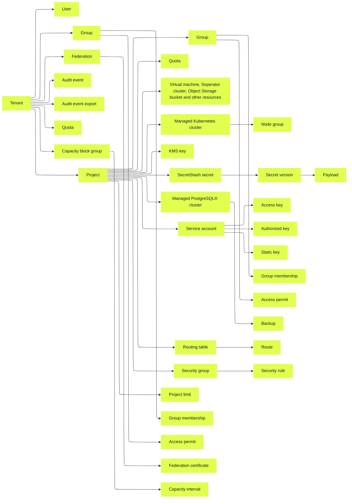

# How resources, identities and access are managed in Nebius AI Cloud

Source: https://docs.nebius.com/iam/overview

> ## Documentation Index
> Fetch the complete documentation index at: https://docs.nebius.com/llms.txt
> Use this file to discover all available pages before exploring further.

# How resources, identities and access are managed in Nebius AI Cloud

In Nebius AI Cloud, you can manage virtual machines, GPU clusters, Kubernetes clusters and Object Storage buckets. These components are called *resources* and are part of a *project*.

You can allow other users in your federation to access your resources. You can also create special *service accounts* that can be used in programming interfaces (for example, the [Nebius AI Cloud CLI](https://docs.nebius.com/cli/index.md)) to manage resources on your behalf. *Groups* are used to provide users and service accounts with different levels of access to resources.

The mentioned entities are combined in a *tenant*, which is a central place for Identity and Access Management in Nebius AI Cloud.

## Resource management

Resources are organized within a *project* and a project is part of a *tenant*.

In the [web console](https://console.nebius.com), project-level resources appear in the navigation sidebar above the **Manage** section. Tenant-level resources, such as billing or Identity and Access Management settings, are listed below **Manage**.

### Tenants

A *tenant* is your workspace in Nebius AI Cloud. It is the largest organizational unit that contains all other entities, including projects, users, quotas and billing information.

A tenant includes:

* Projects, which are isolated workspaces that contain [resources](#resource-hierarchy).
* Groups with identity and access settings.
* User accounts.
* (Optional) A federation and user accounts from it.
* Quotas and billing settings that define resource limits and usage accounting.
* Audit logs that record actions performed within the tenant.

When you [sign up for Nebius AI Cloud](https://docs.nebius.com/signup-billing/sign-up.md), a tenant is created automatically. You can also be added to other tenants and work with their resources. Additionally, you can [create multiple tenants](https://docs.nebius.com/iam/create-tenants.md) of your own and invite users to collaborate within them. You cannot delete a tenant.

To allow a user or a service account to view or manage resources in the tenant, add the required members to a corresponding tenant [group](https://docs.nebius.com/iam/authorization/groups/index.md). Each group can perform different sets of operations with resources.

### Projects

A *project* allows you to create and organize resources. Nebius AI Cloud provides you with a project per [region](https://docs.nebius.com/overview/regions.md) when you [sign up](https://docs.nebius.com/signup-billing/sign-up.md).

Projects ensure isolation between environments. You can group resources by product, ML team or any other criteria. For example, you can keep development and production workloads in separate projects.

A project contains:

* Resources, such as Compute virtual machines, Managed Service for Kubernetes® clusters or Object Storage buckets.
* [Service accounts](#accounts-and-members) for access to resources via the CLI or API.
* Quotas that define resource limits.
* Groups with project-level identity and access settings.

When you sign up for Nebius AI Cloud, a project for your resources is created automatically.

For more information about how to manage projects, see the [instructions](https://docs.nebius.com/iam/manage-projects.md).

### Resource hierarchy

Most resources belong to and are managed by individual Nebius AI Cloud services. For example:

* The Compute service manages virtual machines, disks and shared filesystems.
* The Managed Kubernetes service manages Managed Kubernetes clusters.
* The Object Storage service manages buckets.

Each resource type has a parent–child relationship. The parent defines the scope of permissions and resource inheritance. Projects are the parents of most service resources, while tenants are the parents of projects.

Some resources can include other resources, forming parent–child relationships with them. For example:

* A Managed Kubernetes cluster includes node groups.
* A SecretStash secret includes secret versions.

You can learn which service manages a resource by checking one of the following:

* The documentation section (for example, [Compute](https://docs.nebius.com/compute/index.md), [Object Storage](https://docs.nebius.com/object-storage/index.md)).
* The CLI command group (for example, `nebius compute disk <subcommand>` or `nebius storage bucket <subcommand>`).

In some cases, the web console may show a slightly different organization for usability. For example, disks and shared filesystems appear under **Storage** in the web console, though they are part of the Compute service.

> **All resources and their parent relationships**
>
> <table>
>   <thead>
>     <tr>
>       <td>
>         **Service**
>       </td>
>
>       <td>
>         **Resource**
>       </td>
>
>       <td>
>         **Parent**
>       </td>
>
>       <td>
>         **Associated resource**
>       </td>
>     </tr>
>   </thead>
>
>   <tbody>
>     <tr>
>       <td rowspan="14">
>         Identity and Access Management
>       </td>
>
>       <td>
>         User account
>       </td>
>
>       <td>
>         \-
>       </td>
>
>       <td>
>         \-
>       </td>
>     </tr>
>
>     <tr>
>       <td>
>         Tenant
>       </td>
>
>       <td>
>         \-
>       </td>
>
>       <td>
>         \-
>       </td>
>     </tr>
>
>     <tr>
>       <td>
>         Tenant user account
>       </td>
>
>       <td>
>         Tenant
>       </td>
>
>       <td>
>         \-
>       </td>
>     </tr>
>
>     <tr>
>       <td>
>         Federation
>       </td>
>
>       <td>
>         Tenant
>       </td>
>
>       <td>
>         \-
>       </td>
>     </tr>
>
>     <tr>
>       <td>
>         Federation certificate
>       </td>
>
>       <td>
>         Federation
>       </td>
>
>       <td>
>         \-
>       </td>
>     </tr>
>
>     <tr>
>       <td>
>         Invitation
>       </td>
>
>       <td>
>         Tenant
>       </td>
>
>       <td>
>         Tenant user account
>       </td>
>     </tr>
>
>     <tr>
>       <td>
>         Group
>       </td>
>
>       <td>
>         Tenant\
>         Project
>       </td>
>
>       <td>
>         \-
>       </td>
>     </tr>
>
>     <tr>
>       <td>
>         Group membership
>       </td>
>
>       <td>
>         Group
>       </td>
>
>       <td>
>         Tenant user account\
>         Service account
>       </td>
>     </tr>
>
>     <tr>
>       <td>
>         Access permit
>       </td>
>
>       <td>
>         Group
>       </td>
>
>       <td>
>         Different resource types
>       </td>
>     </tr>
>
>     <tr>
>       <td>
>         Project
>       </td>
>
>       <td>
>         Tenant
>       </td>
>
>       <td>
>         \-
>       </td>
>     </tr>
>
>     <tr>
>       <td>
>         Service account
>       </td>
>
>       <td>
>         Project
>       </td>
>
>       <td>
>         \-
>       </td>
>     </tr>
>
>     <tr>
>       <td>
>         Access key
>       </td>
>
>       <td>
>         Service account
>       </td>
>
>       <td>
>         \-
>       </td>
>     </tr>
>
>     <tr>
>       <td>
>         Authorized public key
>       </td>
>
>       <td>
>         Service account
>       </td>
>
>       <td>
>         \-
>       </td>
>     </tr>
>
>     <tr>
>       <td>
>         Static key
>       </td>
>
>       <td>
>         Project
>       </td>
>
>       <td>
>         Service account
>       </td>
>     </tr>
>
>     <tr>
>       <td rowspan="2">
>         Audit Logs
>       </td>
>
>       <td>
>         Audit event
>       </td>
>
>       <td>
>         Tenant
>       </td>
>
>       <td>
>         \-
>       </td>
>     </tr>
>
>     <tr>
>       <td>
>         Audit event export
>       </td>
>
>       <td>
>         Tenant
>       </td>
>
>       <td>
>         \-
>       </td>
>     </tr>
>
>     <tr>
>       <td rowspan="5">
>         Compute
>       </td>
>
>       <td>
>         Virtual machine (instance)
>       </td>
>
>       <td>
>         Project
>       </td>
>
>       <td>
>         Disk\
>         Service account\
>         GPU cluster\
>         Platform\
>         Subnet\
>         Allocation\
>         Security group
>       </td>
>     </tr>
>
>     <tr>
>       <td>
>         Disk
>       </td>
>
>       <td>
>         Project
>       </td>
>
>       <td>
>         Boot disk image\
>         Disk snapshot
>       </td>
>     </tr>
>
>     <tr>
>       <td>
>         Shared filesystem
>       </td>
>
>       <td>
>         Project
>       </td>
>
>       <td>
>         \-
>       </td>
>     </tr>
>
>     <tr>
>       <td>
>         GPU cluster
>       </td>
>
>       <td>
>         Project
>       </td>
>
>       <td>
>         \-
>       </td>
>     </tr>
>
>     <tr>
>       <td>
>         Platform
>       </td>
>
>       <td>
>         Project
>       </td>
>
>       <td>
>         \-
>       </td>
>     </tr>
>
>     <tr>
>       <td rowspan="2">
>         Managed Kubernetes®
>       </td>
>
>       <td>
>         Cluster
>       </td>
>
>       <td>
>         Project
>       </td>
>
>       <td>
>         Subnet\
>         Allocation
>       </td>
>     </tr>
>
>     <tr>
>       <td>
>         Node group
>       </td>
>
>       <td>
>         Cluster
>       </td>
>
>       <td>
>         GPU cluster\
>         Subnet
>       </td>
>     </tr>
>
>     <tr>
>       <td rowspan="2">
>         Serverless AI
>       </td>
>
>       <td>
>         Endpoint
>       </td>
>
>       <td>
>         Project
>       </td>
>
>       <td>
>         Virtual machine\
>         Shared filesystem\
>         Bucket\
>         Subnet
>       </td>
>     </tr>
>
>     <tr>
>       <td>
>         Job
>       </td>
>
>       <td>
>         Project
>       </td>
>
>       <td>
>         Virtual machine\
>         Shared filesystem\
>         Bucket\
>         Subnet
>       </td>
>     </tr>
>
>     <tr>
>       <td>
>         Managed MLflow
>       </td>
>
>       <td>
>         MLflow cluster
>       </td>
>
>       <td>
>         Project
>       </td>
>
>       <td>
>         Network\
>         Service account
>       </td>
>     </tr>
>
>     <tr>
>       <td rowspan="2">
>         Managed PostgreSQL®
>       </td>
>
>       <td>
>         PostgreSQL cluster
>       </td>
>
>       <td>
>         \-
>       </td>
>
>       <td>
>         Network
>       </td>
>     </tr>
>
>     <tr>
>       <td>
>         Backup
>       </td>
>
>       <td>
>         PostgreSQL cluster
>       </td>
>
>       <td>
>         \-
>       </td>
>     </tr>
>
>     <tr>
>       <td rowspan="4">
>         Limits
>       </td>
>
>       <td>
>         Quota allowance
>       </td>
>
>       <td>
>         Tenant\
>         Project
>       </td>
>
>       <td>
>         \-
>       </td>
>     </tr>
>
>     <tr>
>       <td>
>         Capacity block group
>       </td>
>
>       <td>
>         Tenant
>       </td>
>
>       <td>
>         \-
>       </td>
>     </tr>
>
>     <tr>
>       <td>
>         Capacity interval
>       </td>
>
>       <td>
>         Capacity block group
>       </td>
>
>       <td>
>         Project limit
>       </td>
>     </tr>
>
>     <tr>
>       <td>
>         Project limit
>       </td>
>
>       <td>
>         Project
>       </td>
>
>       <td>
>         Capacity block group
>       </td>
>     </tr>
>
>     <tr>
>       <td rowspan="2">
>         Container Registry
>       </td>
>
>       <td>
>         Registry
>       </td>
>
>       <td>
>         Project
>       </td>
>
>       <td>
>         \-
>       </td>
>     </tr>
>
>     <tr>
>       <td>
>         Image
>       </td>
>
>       <td>
>         Registry
>       </td>
>
>       <td>
>         \-
>       </td>
>     </tr>
>
>     <tr>
>       <td>
>         Object Storage
>       </td>
>
>       <td>
>         Bucket
>       </td>
>
>       <td>
>         Project
>       </td>
>
>       <td>
>         \-
>       </td>
>     </tr>
>
>     <tr>
>       <td rowspan="8">
>         Virtual Networks
>       </td>
>
>       <td>
>         Allocation
>       </td>
>
>       <td>
>         Project
>       </td>
>
>       <td>
>         Pool
>       </td>
>     </tr>
>
>     <tr>
>       <td>
>         Network
>       </td>
>
>       <td>
>         Project
>       </td>
>
>       <td>
>         Pool
>       </td>
>     </tr>
>
>     <tr>
>       <td>
>         Pool
>       </td>
>
>       <td>
>         Project
>       </td>
>
>       <td>
>         \-
>       </td>
>     </tr>
>
>     <tr>
>       <td>
>         Subnet
>       </td>
>
>       <td>
>         Project
>       </td>
>
>       <td>
>         Network\
>         Routing table
>       </td>
>     </tr>
>
>     <tr>
>       <td>
>         Routing table
>       </td>
>
>       <td>
>         Project
>       </td>
>
>       <td>
>         Network
>       </td>
>     </tr>
>
>     <tr>
>       <td>
>         Route
>       </td>
>
>       <td>
>         Routing table
>       </td>
>
>       <td>
>         \-
>       </td>
>     </tr>
>
>     <tr>
>       <td>
>         Security group
>       </td>
>
>       <td>
>         Project
>       </td>
>
>       <td>
>         Network
>       </td>
>     </tr>
>
>     <tr>
>       <td>
>         Security rule
>       </td>
>
>       <td>
>         Security group
>       </td>
>
>       <td>
>         Security group
>       </td>
>     </tr>
>
>     <tr>
>       <td>
>         Key Management Service
>       </td>
>
>       <td>
>         Symmetric or asymmetric key
>       </td>
>
>       <td>
>         Project
>       </td>
>
>       <td>
>         \-
>       </td>
>     </tr>
>
>     <tr>
>       <td rowspan="3">
>         SecretStash
>       </td>
>
>       <td>
>         Secret
>       </td>
>
>       <td>
>         Project
>       </td>
>
>       <td>
>         \-
>       </td>
>     </tr>
>
>     <tr>
>       <td>
>         Secret version
>       </td>
>
>       <td>
>         Secret
>       </td>
>
>       <td>
>         \-
>       </td>
>     </tr>
>
>     <tr>
>       <td>
>         Payload
>       </td>
>
>       <td>
>         Secret version
>       </td>
>
>       <td>
>         \-
>       </td>
>     </tr>
>   </tbody>
> </table>

## Identity management

### Accounts and members

You can use two types of accounts to work with Nebius AI Cloud resources:

* Users from an identity federation.
* Service accounts that are used to manage resources via programming interfaces, such as the [Nebius AI Cloud CLI](https://docs.nebius.com/cli.md). A service account belongs to the project where it was created, but its access to resources is defined by the [groups](https://docs.nebius.com/iam/authorization/groups.md) that it's added to. This means that a service account can be granted access to any resource in the tenant regardless of the project.

### Federations

A *federation* is your identity federation in Nebius AI Cloud.

You can create and manage federations so that your users can log into Nebius AI Cloud through [single sign-on (SSO)](https://docs.nebius.com/iam/federations/saml-sso.md).

### Service account keys

To authenticate in Nebius AI Cloud, service accounts use the following key types:

* [Access keys](https://docs.nebius.com/iam/service-accounts/access-keys.md) are used in services with AWS-compatible APIs, such as Object Storage.
* [Authorized keys](https://docs.nebius.com/iam/service-accounts/authorized-keys.md) are used to obtain IAM tokens for service accounts.

## Access management

Being on the tenant user list does not grant access to resources. Each account should be assigned to a group that specifies the level of access the account has to the tenant resources.

From least to most access, the default groups in a tenant are the following:

* `auditors` can view **certain types** of resources **without access to data**.
* `viewers` can view **most types** of resources (except some resources related to access management, security, etc.) and **access data** in them (e.g. download objects in buckets).
* `editors` can view **and manage** most types of resources and access data in them.
* `admins` can view and manage **all types** of resources and access data in them.

For more information, see [groups description](https://docs.nebius.com/iam/authorization/groups/index.md).

Authentication methods vary depending on the type of account and interface used. For more details, see [How to authenticate in Nebius AI Cloud interfaces](https://docs.nebius.com/iam/log-in.md).

***

*Postgres, PostgreSQL and the Slonik Logo are trademarks or registered trademarks of the PostgreSQL Community Association of Canada, and used with their permission.*
