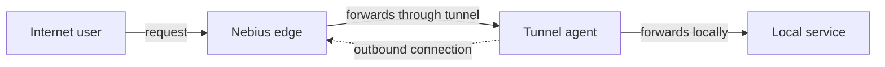

# About Nebius Tunnels

Source: https://docs.nebius.com/tunnels/overview

> ## Documentation Index
> Fetch the complete documentation index at: https://docs.nebius.com/llms.txt
> Use this file to discover all available pages before exploring further.

# About Nebius Tunnels

Nebius Tunnels lets you expose a service running on a virtual machine (VM), on your laptop or behind a firewall to the internet without opening inbound firewall ports, assigning a public IP address to the service or configuring DNS and TLS certificates.

## How tunnels work

A tunnel consists of:

* A tunnel resource in Nebius AI Cloud.
* A tunnel agent that runs next to your application.
* One or more services in the agent configuration. Each service maps a public tunnel URL to a local HTTP or TCP endpoint.

The agent opens an outbound TLS connection to a regional Nebius edge endpoint. When a client sends a request to the public tunnel URL, the edge forwards the request back through the existing agent connection. The VM or private network doesn't need to accept inbound connections from the internet for this traffic.



## Supported traffic

Nebius Tunnels supports:

* HTTP services over HTTP/1.1, including WebSocket upgrade requests.
* HTTP services over HTTP/2, including gRPC, by setting `protocol: h2` in the agent configuration.
* TCP services.
* Multiple services in one tunnel, each with its own service name and public URL.

The agent-to-edge tunnel connection uses HTTP/2 multiplexing, so multiple client requests can share the same outbound connection from the agent to the edge.

Each public URL uses this format:

```text theme={null}
https://<service_name>-<tunnel_masked_ID>.tunnel.applications.<region>.nebius.cloud
```

Where:

* `service_name` is the `services.name` value from the agent configuration.
* `tunnel_masked_ID` is the mask of the tunnel ID without the `applicationtunnel-` prefix and regional routing code. For example, for `applicationtunnel-e00abcdef123456789`, the tunnel ID mask is `abcdef123456789`.
* `region` is the [region](https://docs.nebius.com/overview/regions.md) of the project where the tunnel was created, for example `eu-north1`.

In the agent configuration, `services.name` can contain up to 20 characters and must use only lowercase Latin letters and digits (`[a-z0-9]`). Don't use dashes or dots.

## Authentication and access

The tunnel agent authenticates with [Identity and Access Management](https://docs.nebius.com/iam/index.md). To connect to a tunnel, the service account used by the agent must have the `applicationtunnel.agent` role on that tunnel or on one of its parent resources.

> [!WARNING]
>
> Nebius Tunnels secures the transport between the tunnel agent and Nebius edge, but it doesn't add user authentication or authorization to your application. Configure access control in the application itself before exposing it through a tunnel.

The tunnel agent can authenticate as a service account by using:

* An [authorized key pair](https://docs.nebius.com/iam/service-accounts/authorized-keys.md). This method works on Compute VMs and other hosts.
* Metadata authentication, available on Compute VMs where you [specified a service account when creating the VM](https://docs.nebius.com/cli/compute-vm.md#specifying-the-service-account-on-vm-creation).

## What's next

* [Get started with Nebius Tunnels](https://docs.nebius.com/tunnels/quickstart.md)
* [Create a tunnel](https://docs.nebius.com/tunnels/create.md)
* [Connect to a tunnel](https://docs.nebius.com/tunnels/connect.md)
