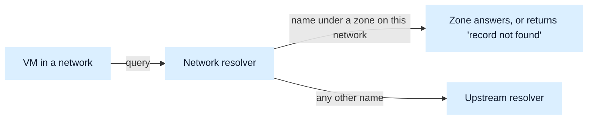

# About DNS

Source: https://docs.nebius.com/vpc/dns/overview

> ## Documentation Index
> Fetch the complete documentation index at: https://docs.nebius.com/llms.txt
> Use this file to discover all available pages before exploring further.

# About DNS

DNS in Nebius AI Cloud resolves names privately inside a [network](https://docs.nebius.com/vpc/overview.md#network). A *DNS zone* is attached to exactly one network, and the names in it resolve only from workloads in that network, never from the internet.

These names give your workloads stable internal endpoints, which you can serve under a domain name of your choosing rather than the one that Nebius AI Cloud assigns.

DNS zones and records are subject to [quotas and constraints](https://docs.nebius.com/vpc/dns/resources/quotas-limits.md).

## How name resolution works

Every virtual machine (VM) in a network sends its DNS queries to the network resolver at `169.254.169.2`, which Nebius AI Cloud configures on the VM automatically. The resolver answers from the zones attached to the VM's network and forwards every other name to an upstream resolver managed by Nebius AI Cloud. You can't replace this resolver or forward a domain to a name server of your own. A zone answers authoritatively for every name under its domain name, so a query for a name that the zone doesn't contain returns a "record not found" response rather than being forwarded.

## DNS zones

A zone is a container for a domain name and every name under it. Its domain name is a fully qualified domain name ([FQDN](https://docs.nebius.com/compute/virtual-machines/fqdn.md)) that ends with a dot, for example, `my.example.`. Neither the domain name nor the attached network can change after the zone is created. To serve the same domain name in another network, [create a second zone](https://docs.nebius.com/vpc/dns/manage-zones.md#creating-dns-zones) there. Zones that share a domain name across networks are independent and hold separate records.

A network can't contain two zones with the same domain name, but it can contain zones whose domain names nest. If a network contains both `my.example.` and `sub.my.example.`, the zone with the longest matching domain name answers, so names under `sub.my.example.` are never served from `my.example.`.

For instructions, see [Managing DNS zones](https://docs.nebius.com/vpc/dns/manage-zones.md).

## DNS records

A *record* holds one name, type and value inside a zone. To serve several values for one name, [create several records](https://docs.nebius.com/vpc/dns/manage-records.md#creating-dns-records) that share a relative name and type. A record's relative name joined to the zone's domain name is the name that the record answers at, for example, `www` in the zone `my.example.` answers queries for `www.my.example.`.

For instructions, see [Managing DNS records](https://docs.nebius.com/vpc/dns/manage-records.md).

## System-managed and custom zones

Every network has a system-managed zone, `<network_ID>.compute.internal.`, with a record for each VM's [FQDN](https://docs.nebius.com/compute/virtual-machines/fqdn.md). You can't change this zone or its records.

Nebius AI Cloud configures `compute.internal` and `<network_ID>.compute.internal` as search domains on every VM. A VM appends these domains to a short name before it queries the resolver, so it reaches another VM in the same network by that VM's hostname or ID alone.

When you [add custom zones](https://docs.nebius.com/vpc/dns/manage-zones.md#creating-dns-zones) to a network, VMs in the network resolve names from both the custom zones and the system-managed zone. Names in custom zones don't resolve by short name, so to reach the record `www` in the zone `my.example.`, query `www.my.example.`.

## Choosing a zone domain name

Use a domain name that you don't need to resolve publicly from the same network, because the zone answers authoritatively for its whole domain name. If you name a zone after a publicly resolved domain, workloads in the network lose every name in that domain except the ones that you recreate in the zone.

Some domain names aren't available for a zone. See [DNS quotas and constraints](https://docs.nebius.com/vpc/dns/resources/quotas-limits.md#constraints).

## Roles and permissions

Access to DNS zones and records comes from the [general roles](https://docs.nebius.com/iam/authorization/roles.md#general-roles) that a [group](https://docs.nebius.com/iam/authorization/groups/index.md) holds within the tenant or project. The only role that treats the two differently is `auditor`, which can view zones but not records.

## What's next

* [Managing DNS zones](https://docs.nebius.com/vpc/dns/manage-zones.md)
* [Managing DNS records](https://docs.nebius.com/vpc/dns/manage-records.md)
* [DNS quotas and constraints](https://docs.nebius.com/vpc/dns/resources/quotas-limits.md)
